# Interface, criptografia de senha e controle de acesso

A interface é uma aplicação desktop em Java 17 com Swing e JDBC, organizada com um arquivo por tela. Ela não contém regra de negócio: chama procedures, consulta views e mostra a mensagem que o banco devolver.

## Estrutura da aplicação

| Classe | Papel |
|---|---|
| `SgaApplication` | Ponto de entrada: instala o tema visual e abre o login |
| `LoginFrame` | Tela de login: calcula o hash da senha e chama `sp_LoginUsuario` |
| `DashboardFrame` | Janela principal: menu lateral montado conforme o perfil, consultas e matrícula |
| `AlunosFrame` | Cadastro, edição e exclusão de alunos |
| `NotasFrame` | Lançamento de notas, faltas e exame (Coordenador) |
| `RelatoriosFrame` | Relatórios de desempenho, lotação e faturamento (Coordenador) |
| `AuditoriaFrame` | Auditoria das alterações de nota, lida do `log_nota` (Coordenador) |
| `InicioPanel`, `GraficoDesempenho`, `Cartoes` | Painel inicial com cartões e gráfico, e o cartão de CR do aluno |
| `SgaRepository` | **Única** classe que fala com o banco: um método por procedure ou view |
| `DatabaseConfig` | Abre a conexão JDBC a partir de variáveis de ambiente |
| `PasswordHash` | Calcula o SHA-256 da senha |
| `Tema`, `Tabelas` | Aparência e utilitários de tabela compartilhados pelas telas |

### Regras seguidas no acesso ao banco

- Só existem dois tipos de acesso: `CALL sp_...(?, ?, ...)` e `SELECT ... FROM vw_...`. Nenhum `INSERT`, `UPDATE` ou `DELETE` aparece no código Java.
- Todos os valores vão como parâmetros (`CallableStatement` e `PreparedStatement`); nenhum texto digitado é concatenado em uma consulta.
- As consultas de views sem parâmetro passam por uma lista de nomes permitidos (`vw_turmas_lotacao`, `vw_desempenho_turma`, `vw_faturamento_curso` e `vw_cr_aluno`), e qualquer outro nome é recusado.
- A senha do banco não está no código nem no repositório: a conexão lê `SGA_DB_USER`, `SGA_DB_PASSWORD` e `SGA_DB_URL` do ambiente.
- As colunas dos resultados são localizadas pelo **nome**, e não pela posição, para a tela continuar certa se uma view ganhar colunas.

## Criptografia de senha

1. O usuário digita a senha, que fica em um `char[]` (e não em uma `String`).
2. A aplicação calcula o **SHA-256** em hexadecimal minúsculo e apaga o `char[]` e os bytes da memória.
3. Só o hash viaja: `CALL sp_LoginUsuario(login, hash)`.
4. A procedure compara o hash com `usuario.senha_hash` (`CHAR(64)`) e devolve id, nome, e-mail e perfil. Nunca devolve a senha.
5. Se login ou senha não conferirem, o resultado é vazio e a tela diz apenas "Login ou senha inválidos", sem revelar qual dos dois errou.

A massa de dados grava `SHA2('Senha@123', 256)`, o mesmo valor que a aplicação calcula.

## Controle de acesso por perfil

O acesso é controlado em **duas camadas independentes**: a tela esconde o que o perfil não pode usar, e o banco recusa a operação mesmo se alguém chamar a procedure diretamente.

| Função | Secretário | Coordenador | Onde é barrado no banco |
|---|:---:|:---:|---|
| Consultar turmas, boletim e histórico | sim | sim | |
| Cadastrar, editar e excluir alunos | sim | sim | |
| Matricular aluno | sim | sim | |
| Lançar notas e faltas | não | sim | `sp_lancar_notas` |
| Lançar exame | não | sim | `sp_lancar_exame` |
| Fechar semestre | não | sim | `sp_fechar_semestre` |
| Relatórios de desempenho e faturamento | não | sim | controle na tela (as views são só de leitura) |
| Auditoria de notas | não | sim | controle na tela (a view é só de leitura) |
| Painel inicial | sim | sim | o cartão de faturamento só aparece para o Coordenador |

Para o Secretário, o menu não mostra "Notas e exame", "Fechar semestre", "Relatórios" nem "Auditoria", e o painel inicial não mostra o faturamento; portanto ele não tem acesso a financeiro nem ao fechamento de turmas. Se uma dessas procedures for chamada com o usuário de um Secretário, o banco responde, por exemplo, "Apenas o Coordenador pode fechar o semestre." (casos de teste I5 a I7, na seção de testes).

## Telas

### Login

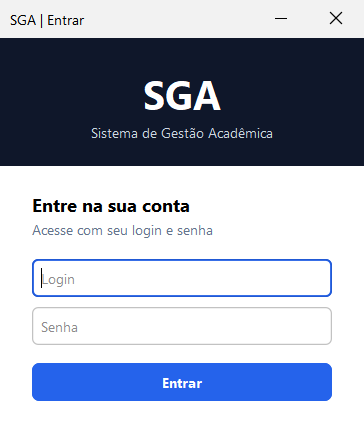

### Perfil Secretário

O menu lateral mostra só as seções de consultas e de secretaria. A tela inicial é um painel com cartões (turmas abertas, alunos ativos e média geral) e um gráfico de aprovados × reprovados por turma, todos lidos das views. O cartão de faturamento não aparece para o Secretário.

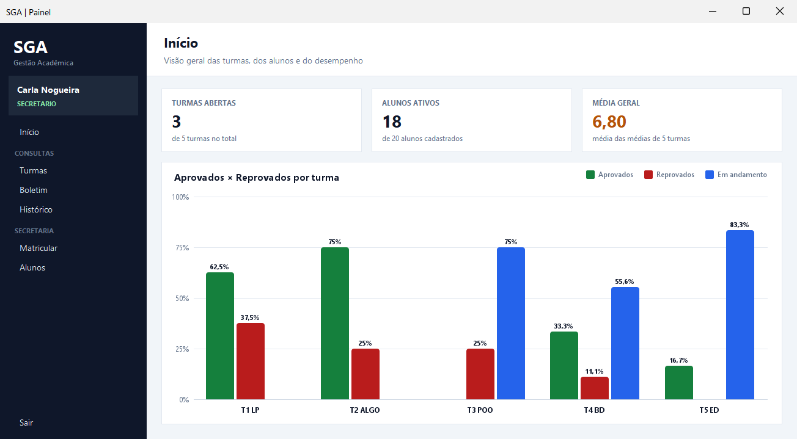

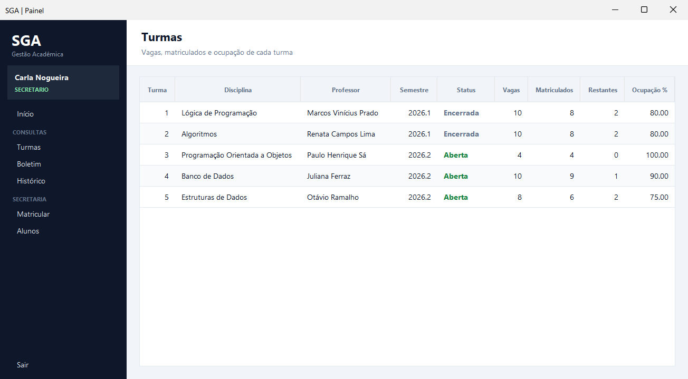

**Alunos.** A lista vem da view `vw_alunos`, e as ações chamam `sp_cadastrar_aluno`, `sp_editar_aluno` e `sp_excluir_aluno`.

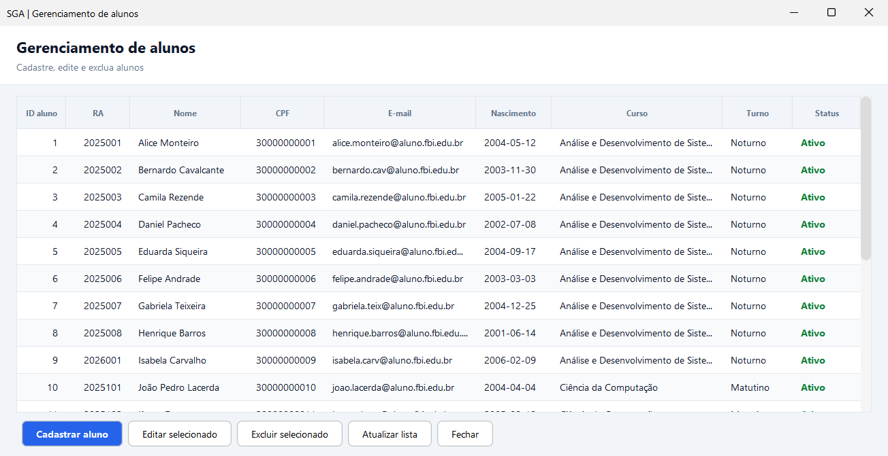

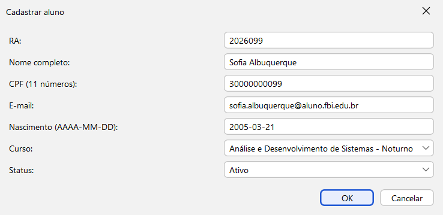

**Matrícula.** O Secretário escolhe o aluno (só os ativos) e a turma (só as abertas e com vaga) em listas, sem digitar identificadores. Antes de gravar, a tela pede confirmação. O banco valida vaga, pré-requisito e situação do aluno.

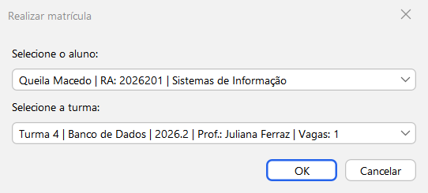

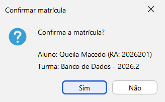

**Boletim e histórico.** O boletim usa a view `vw_boletim` e o histórico usa `sp_historico_aluno`. Os dois mostram, no topo, o **Coeficiente de Rendimento (CR)** do aluno, calculado pela function opcional `fn_cr_aluno` e lido pela view `vw_cr_aluno`. O CR é a média final ponderada pela carga horária das disciplinas concluídas; aluno sem disciplina concluída mostra "sem disciplinas concluídas".

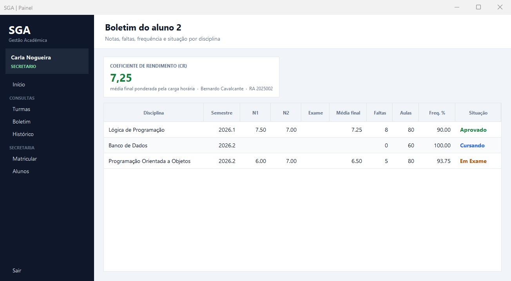

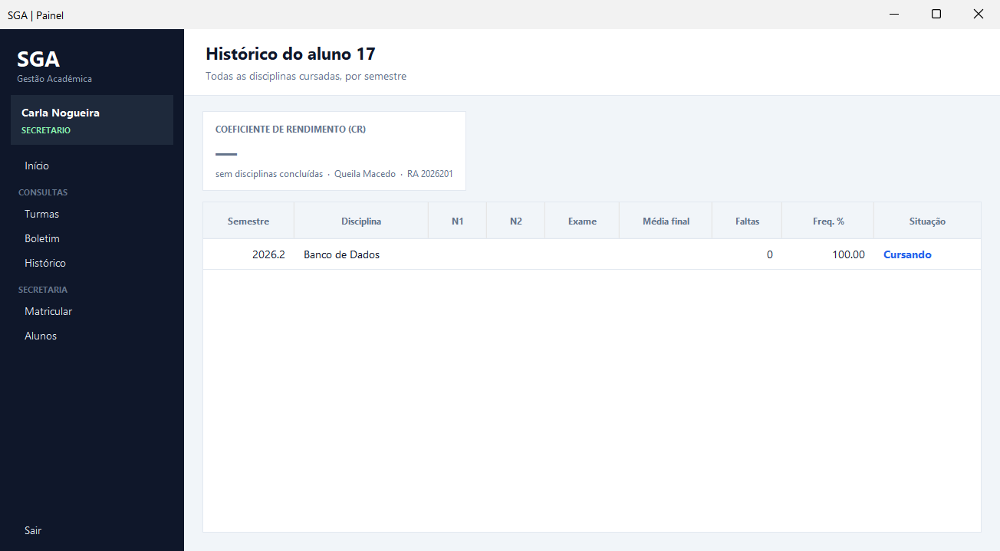

### Perfil Coordenador

O Coordenador vê, além do que o Secretário vê, a seção de coordenação e o cartão de faturamento mensal previsto, em reais, no painel inicial.

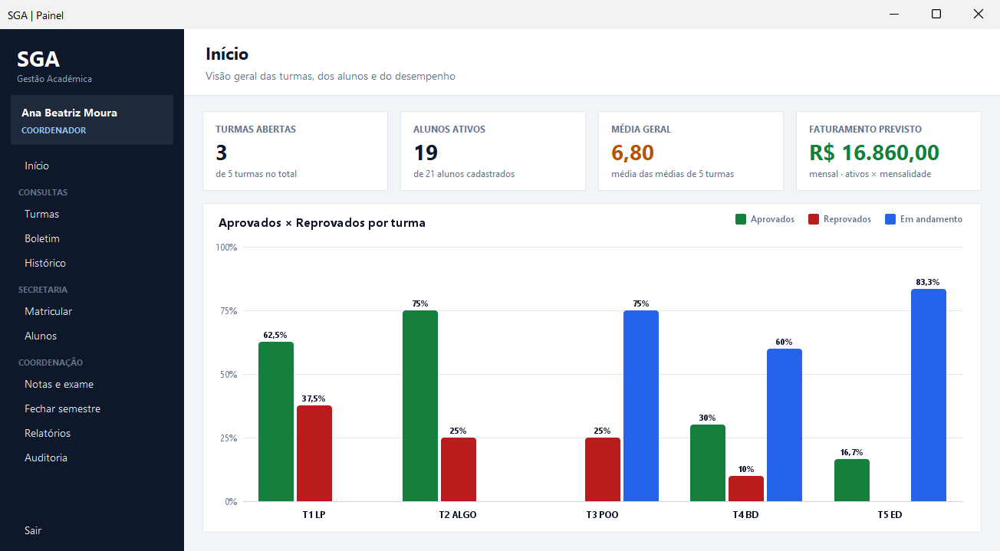

**Notas e exame.** O Coordenador escolhe uma turma aberta e vê as matrículas dela (`vw_boletim`, filtrada por turma). Ao selecionar uma linha, lança N1, N2 e faltas (`sp_lancar_notas`) ou o exame (`sp_lancar_exame`, só para quem está "Em Exame"). A média e a situação são recalculadas pelos triggers, e a tabela mostra o resultado na hora. A situação aparece colorida: verde para aprovado, vermelho para reprovado, laranja para exame e azul para cursando.

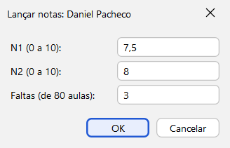

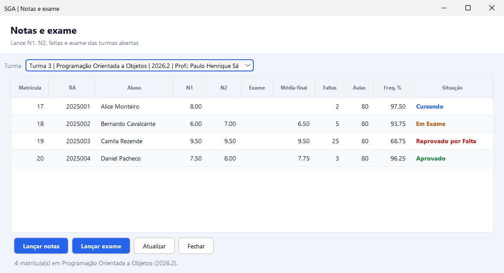

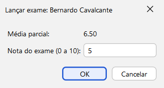

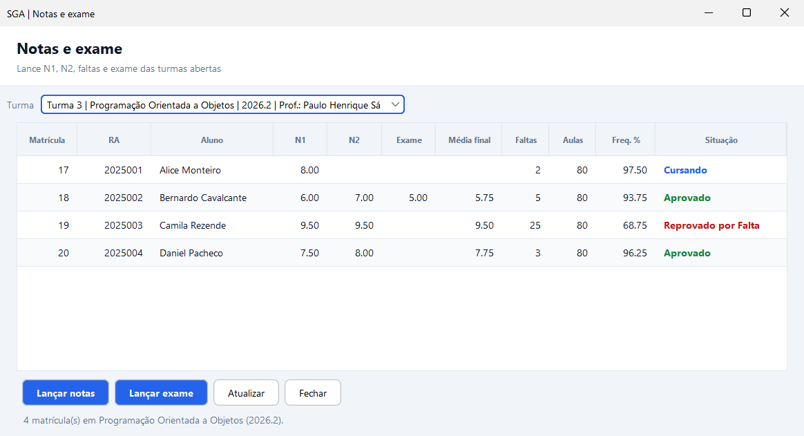

**Auditoria de notas (RN08).** Mostra o `log_nota`, preenchido pelo trigger `trg_auditoria_nota`: para cada campo alterado, o aluno, a disciplina, o valor antigo e o novo, quem alterou e quando. A view usada é a `vw_log_nota`. Ao lançar uma nota em "Notas e exame" e voltar para a Auditoria, as linhas novas já estão lá, o que mostra o trigger funcionando em tempo real.

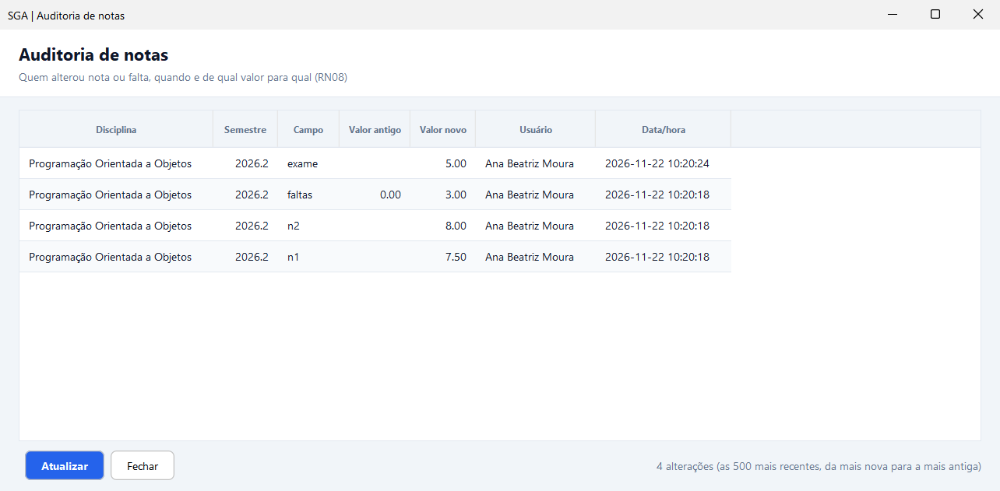

**Fechar semestre.** A tela lista só os semestres que ainda têm turma aberta, pede confirmação e chama `sp_fechar_semestre`, que age em transação: ou fecha tudo ou não muda nada. Se alguma matrícula ainda estiver sem N1 ou N2, o fechamento é recusado e a mensagem aponta o aluno. No sucesso, a tela mostra o resumo de matrículas por situação.

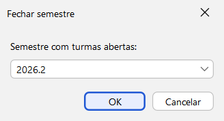

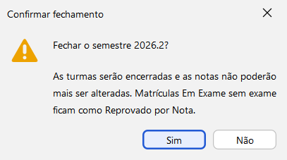

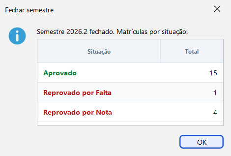

**Relatórios.** Três abas, todas lidas de views: desempenho por turma (`vw_desempenho_turma`), lotação das turmas (`vw_turmas_lotacao`) e faturamento por curso (`vw_faturamento_curso`), este com o total mensal em reais.

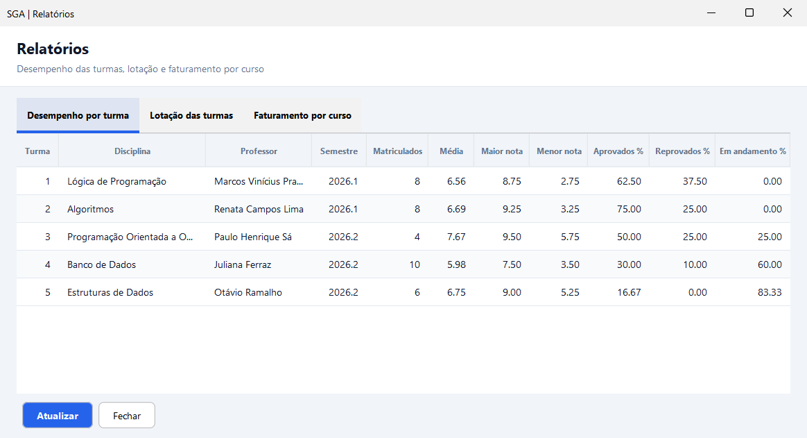

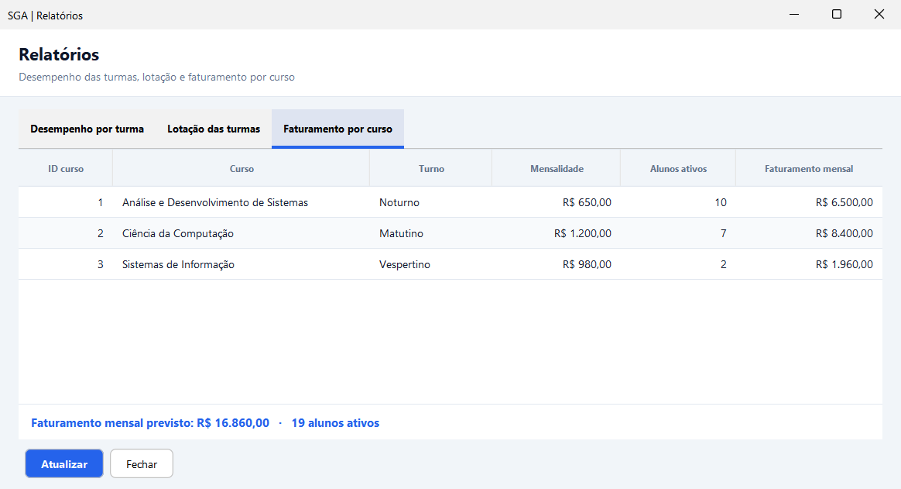
